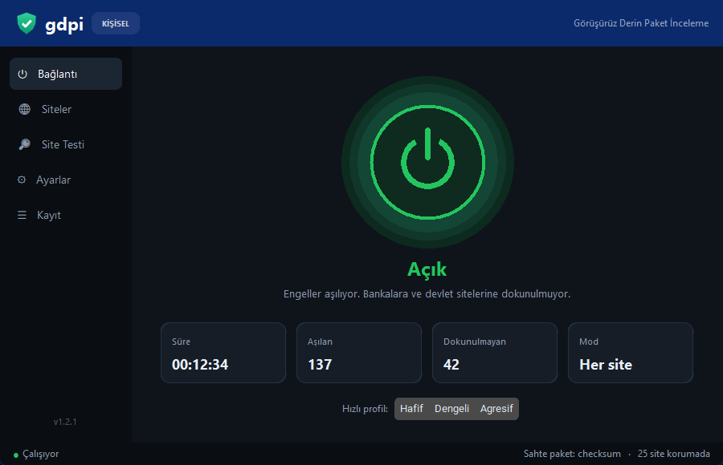
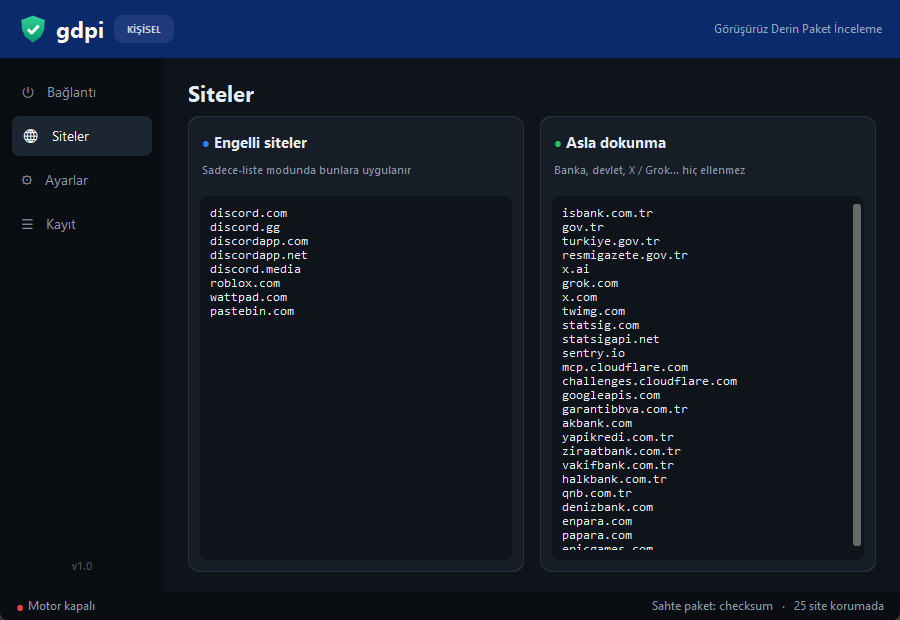
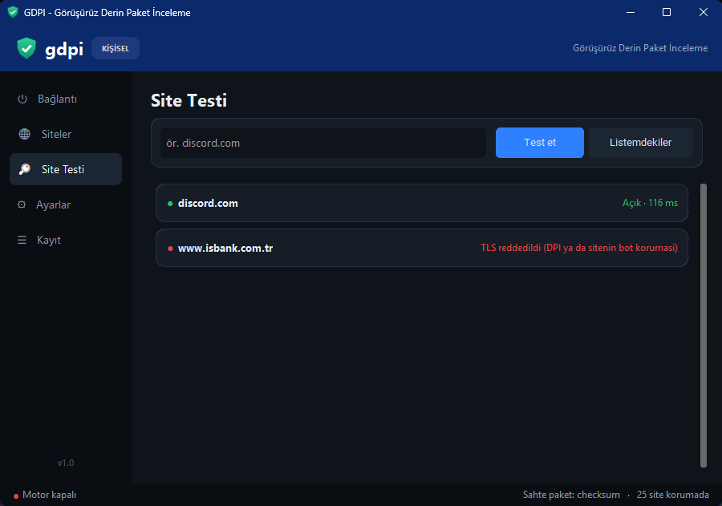
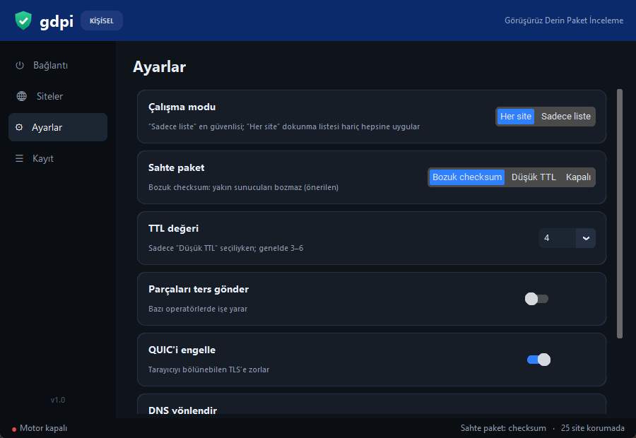
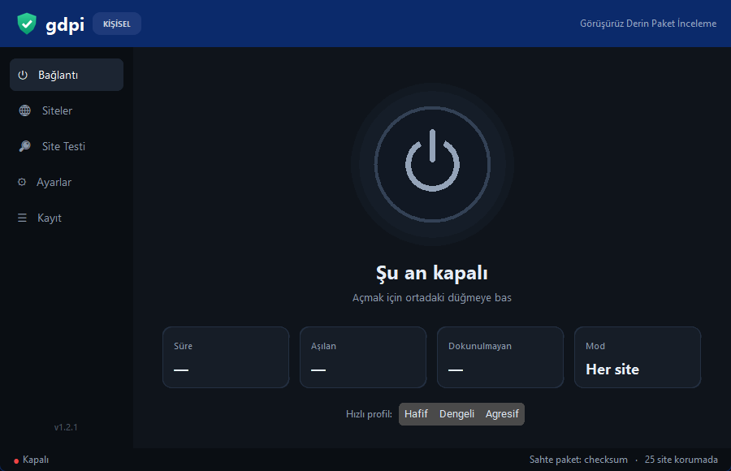

<p align="center">
  
</p>

<h1 align="center">GDPI: Görüşürüz Derin Paket İnceleme</h1>

<p align="center">
  GoodbyeDPI'ın yaptığı işi yapan, ama bankanı, e-Devlet'ini ve Grok'unu bozmayan küçük bir araç.<br>
  <a href="../../releases/latest"><b>Son sürümü indir</b></a> (Windows ve Linux)
</p>

---

## Neden yaptım?

Uzun süre GoodbyeDPI kullandım. İşini görüyordu ama her siteye karıştığı için başka şeyleri bozuyordu.
İşbankası takılıyordu, Resmî Gazete açılmıyordu, bilgisayardaki Grok uygulaması saçmalıyordu. Ben de aynı fikri
biraz daha kibar uygulayan bir şey yazdım.

GDPI'ın farkı, hangi siteye dokunacağını bilmesi. Bankalar, `gov.tr` siteleri, X ve Grok bir "asla dokunma"
listesinde duruyor ve bunların trafiğine hiç karışmıyor. İstersen ayarı tamamen tersine çevirip sadece engelli
sitelere (Discord gibi) uygulatabilirsin, geri kalan her şey hiç GDPI yokmuş gibi çalışır.

Birkaç küçük şey daha var:

- Sahte paketleri bozuk checksum ile gönderiyor. GoodbyeDPI'daki düşük TTL yöntemi bazen yakındaki Türk
  sunucularına ulaşıp bağlantıyı bozuyordu, bu yöntemde sunucu sahte paketi hiçbir zaman kabul etmiyor.
  İstersen TTL yöntemine de geçebilirsin.
- Paketi rastgele bir yerden değil, alan adının tam ortasından bölüyor.
- İçinde bir site testi var. Bir site açılmıyorsa sebebinin DNS mi yoksa engel mi olduğunu orada görebilirsin.
- Kapatınca sağ alttaki simgeye iniyor, istersen Windows açılırken kendiliğinden başlıyor.

## Kurulum

### Windows

[Releases](../../releases/latest) sayfasından **GDPI-windows.zip**'i indir, bir klasöre çıkar ve içindeki
**GDPI.exe**'yi aç. Yönetici izni isteyecek. Ağ paketlerine erişmek için buna ihtiyacı var, "Evet" de.
Sonra ortadaki düğmeye bas, yeşile dönerse çalışıyor demektir.

Exe imzasız olduğu için Windows SmartScreen "tanınmayan uygulama" diyebilir. **Ek bilgi → Yine de çalıştır**
ile açabilirsin. İçine ne girdiğinden emin olmak istersen kodun tamamı burada, kendin de derleyebilirsin.

winget'e de eklemeyi düşünüyorum ama henüz başvurmadım. Şimdilik zip'ten kurman gerekiyor.

### Linux

Önce gerekenleri bir kere kur:

```
sudo apt install python3-venv python3-tk nftables      # Fedora: sudo dnf install python3-tkinter nftables
```

Sonra [Releases](../../releases/latest) sayfasından **GDPI-linux.tar.gz**'i indir:

```
tar -xzf GDPI-linux.tar.gz
cd GDPI
./gdpi.sh
```

`gdpi.sh` ilk açılışta kendine bir Python ortamı kuruyor, sonra GDPI'ı yönetici izniyle açıyor. Arayüz
Windows'takiyle aynı, ayarlar `~/.config/GDPI/` altında duruyor. Linux'ta WinDivert yerine çekirdeğin kendi
NFQUEUE özelliği kullanılıyor, ayrıca sürücü kurman gerekmiyor. GDPI kapanınca kuralları siliyor. Bir şekilde
çökerse bile internetin kesilmiyor, kalan kuralı `sudo nft delete table inet gdpi` ile temizleyebilirsin.

Linux'ta "Windows ile başlat" ayarı yok. GNOME'da tepsi simgesi için AppIndicator eklentisi gerekebilir, o
yoksa pencereyi kapatınca GDPI da kapanıyor.

### Kaynaktan

```
git clone https://github.com/TechnoDiance23/gdpi.git
cd gdpi
GDPI.bat        # Linux'ta: ./gdpi.sh
```

`GDPI.bat` eksik Python paketlerini kendisi kuruyor (Python 3.10 ya da üstü lazım). Kendi exe'ni derlemek
istersen `powershell -ExecutionPolicy Bypass -File build.ps1` yeterli, sonuç `dist\GDPI\GDPI.exe` oluyor.

## Nasıl kullanılır?

Ana ekrandaki düğme GDPI'ı açıp kapatıyor. Altında ne kadar süredir açık olduğunu ve kaç bağlantıya karıştığını
görüyorsun. Hafif, Dengeli ve Agresif diye üç hazır profil var. Bir şey çalışmazsa önce bunları dene.

**Siteler** sayfasında iki liste var: solda engelli siteler, sağda asla dokunulmayacaklar. Her satıra bir alan
adı yazman yeterli, alt alan adları da otomatik kapsanıyor. **Site Testi**'nde tek bir siteyi ya da listedekilerin
hepsini deneyebilirsin. **Ayarlar**'dan modu, sahte paket türünü, QUIC ve DNS ayarlarını değiştirebilirsin.
"Kaydet ve uygula" deyince GDPI'ı kapatıp açmana gerek kalmadan hemen geçerli oluyor.

<p align="center">
   
</p>
<p align="center">
   
</p>

### Bir site açılmıyorsa

Önce Site Testi'nde dene. "DNS engellenmiş" diyorsa Ayarlar'dan DNS yönlendirmeyi aç. Değilse profili Agresif'e
al ya da sahte paketi Düşük TTL'ye çevirip 3 ile 6 arasında değerler dene. Tersi olursa, yani bir site GDPI
açıkken bozuluyorsa, adını "asla dokunma" listesine ekle.

### Bilmende fayda var

GoodbyeDPI'ı tamamen kapat. Servis olarak kurduysan `service_remove.cmd` ile kaldır. İkisi aynı anda çalışınca
birbirini bozuyor ve bankalar açılmıyor.

Windows Defender, GoodbyeDPI'da da olduğu gibi WinDivert'i "istenmeyebilecek uygulama" diye işaretleyebilir.
İçindeki sürücü WinDivert'in resmi ve imzalı sürücüsü. Defender engellerse GDPI klasörüne izin vermen gerekiyor.

Bir sorun çıkarsa `%APPDATA%\GDPI\cikti.log` dosyasına bak. `GDPI.exe --selftest` komutu da GDPI'ı açıp birkaç
siteyi deniyor ve sonucu `selftest.txt` dosyasına yazıyor.

Ayarların `%APPDATA%\GDPI\ayarlar.json` dosyasında. GDPI bu dosyayı açarken her değeri kontrol ediyor, saçma bir
şey görürse (tanımadığı bir DNS sunucusu, bozuk bir alan adı) varsayılan değere dönüyor.

"Windows ile başlat" açıkken GDPI kendini `C:\Program Files\GDPI\` klasörüne kopyalayıp oradan çalışıyor. Oraya
sadece yöneticiler yazabildiği için başka bir program GDPI'ın yerine geçip yönetici yetkisi kapamıyor.

GDPI bir VPN değil, IP adresini gizlemiyor. Hiçbir veri toplamıyor ve hiçbir yere bağlanmıyor, sadece senin
bilgisayarından çıkan paketleri yeniden düzenliyor.

## Nasıl çalışıyor?

Operatörler engellemeyi genelde şifreli bağlantının ilk paketine bakarak yapıyor. O pakette gitmek istediğin
sitenin adı (SNI) açık olarak yazıyor. GDPI bu paketi yakalıyor, alan adının tam ortasından ikiye bölüyor ve önüne
operatörün göreceği ama sunucunun asla kabul etmeyeceği bir sahte paket koyuyor. Operatör site adını bütün halinde
göremiyor, sunucu ise parçaları normal şekilde birleştiriyor. Windows'ta paketleri yakalamak için
[WinDivert](https://reqrypt.org/windivert.html), Linux'ta NFQUEUE kullanılıyor.

## Teşekkürler ve lisans

Fikir [GoodbyeDPI](https://github.com/ValdikSS/GoodbyeDPI) (ValdikSS) ve [zapret](https://github.com/bol-van/zapret)'ten
geliyor. GDPI onların kodunu içermiyor, aynı yaklaşımı Python ile sıfırdan uyguluyor. Paketleri yakalamak için
GoodbyeDPI ile aynı sürüm olan [WinDivert 2.2.2](https://reqrypt.org/windivert.html) kullanılıyor (LGPLv3 / GPLv2
çift lisanslı, GDPI'da LGPLv3). Arayüz [CustomTkinter](https://github.com/TomSchimansky/CustomTkinter) (MIT),
[pystray](https://github.com/moses-palmer/pystray) (LGPLv3) ve [Pillow](https://github.com/python-pillow/Pillow)
(MIT-CMU) ile yapıldı.

GDPI'ın kendi kodu **MIT** lisanslı, bkz. [LICENSE](LICENSE). Diğer bileşenlerin lisansları
[THIRD_PARTY.md](THIRD_PARTY.md) dosyasında, tam metinleri [licenses/](licenses/) klasöründe ve indirdiğin zip'in
içinde. LGPL bileşenlerinin kaynak kodu da her sürüme ayrıca ekleniyor.

Görüşürüz, derin paket inceleme.
